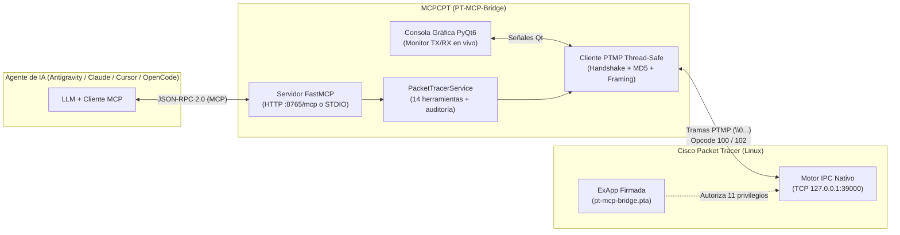

# 🌐 MCPCPT (`PT-MCP-Bridge`)
### **Universal AI-to-Cisco Packet Tracer Bridge via Model Context Protocol (MCP) & Native PTMP IPC**

[](LICENSE)
[](https://www.python.org/)
[](https://modelcontextprotocol.io/)
[](https://linuxmint.com/)
[](https://pypi.org/project/PyQt6/)

**MCPCPT (`PT-MCP-Bridge`)** es un puente nativo para Linux que conecta **cualquier Inteligencia Artificial compatible con el estándar MCP (Model Context Protocol)** directamente con el motor interno de **Cisco Packet Tracer** en tiempo real a través de su protocolo propietario **PTMP (Packet Tracer Messaging Protocol)**.

Con este puente, un agente de IA puede **diseñar topologías desde cero, agregar routers/switches/PCs, tender cualquier tipo de cableado, configurar IOS por CLI, asignar direccionamiento IPv4/DHCP, adelantar el reloj de simulación, auditar tablas de enrutamiento y verificar conectividad extremo a extremo con `ping`** sin intervención manual.

> **Creado por:** **David Fernando Bedoya Ramirez**

---

## 🤖 ¿Con qué Inteligencias Artificiales funciona?

Al implementar el estándar abierto **Model Context Protocol (MCP)** tanto por **Streamable HTTP (`http://127.0.0.1:8765/mcp`)** como por **STDIO (`--stdio`)**, funciona con **cualquier cliente o agente MCP**, incluyendo:

| Agente / IDE de IA | Modelos Soportados | Transporte Recomendado |
| :--- | :--- | :--- |
| **Google Antigravity** | Gemini, Claude, GPT | Streamable HTTP (`http://127.0.0.1:8765/mcp`) |
| **Claude Desktop / Claude Code** | Claude Opus / Sonnet / Haiku | STDIO (`--stdio`) o Streamable HTTP |
| **Cursor / Windsurf** | Claude, GPT-4o, Gemini, DeepSeek | Streamable HTTP o STDIO |
| **OpenCode / Cline / Continue / Roo Code** | OpenAI, Anthropic, Ollama, OpenRouter, modelos locales | Streamable HTTP o STDIO |

---

## 🏗️ Arquitectura y Funcionamiento Interno

Cisco Packet Tracer **no utiliza JSON ni HTTP** en su puerto IPC (`TCP 39000`): utiliza un protocolo binario/texto propietario llamado **PTMP (*Packet Tracer Messaging Protocol*)** sobre sockets TCP con tramas prefijadas por longitud y delimitadas por bytes nulos (`<len>\0<campos>\0`), negociación de sesión, autenticación criptográfica **MD5 Challenge-Response** y llamadas encadenadas a objetos internos de C++/Qt (`opcode 100`).



### Las 5 capas del proyecto (`src/pt_mcp_bridge/`)

1. **Capa de Protocolo PTMP ([`src/pt_mcp_bridge/ipc/protocol.py`](src/pt_mcp_bridge/ipc/protocol.py))**:
   - Implementa el *framing* exacto de Packet Tracer: `<longitud_bytes>\0<campo_1>\0...\0`.
   - Realiza el handshake `PTMP\01\0{UUID}` (mensajes `0`/`1`), envío de `App ID` (`2`), recepción de desafío `Challenge` (`3`) y firma MD5 en mayúsculas `MD5(challenge + secret)` (`4` → `5`).
   - Serializa e interpreta cadenas de llamadas a métodos (`opcode 100`), errores (`101`) y valores de retorno (`102`), respetando la diferencia crítica de tipos internos de Qt (`0 = END_OF_ARGUMENTS`, `2 = bool`, `4 = int`, `8 = std::string`, `9 = QString`).
2. **Cliente TCP Thread-Safe ([`src/pt_mcp_bridge/ipc/client.py`](src/pt_mcp_bridge/ipc/client.py))**:
   - Mantiene el socket persistente hacia `127.0.0.1:39000`, correlaciona peticiones concurrentes por `request_id`, reconecta automáticamente con *exponential backoff* y emite eventos en tiempo real (`tx`, `rx`, `info`, `warn`, `error`) hacia la interfaz gráfica.
3. **Constructores de Llamadas IPC ([`src/pt_mcp_bridge/calls.py`](src/pt_mcp_bridge/calls.py))**:
   - Traduce operaciones de red a cadenas de objetos C++/Qt de Packet Tracer (`network().addDevice(...)`, `network().createLink(...)` con códigos enteros `ConnectType 8100..8117`, `Device.enterCommand(...)`, `appWindow().fastForwardTime()`, configuración IP/DHCP en `HostPort`, etc.).
4. **Servicio de Alto Nivel y Auditoría ([`src/pt_mcp_bridge/service.py`](src/pt_mcp_bridge/service.py))**:
   - Orquesta las 14 operaciones del puente, incluyendo **recuperación automática de submodos IOS** (`auto-exit` cuando un comando es rechazado dentro de `config-if` o `config-router`), extracción limpia de texto HTML del enunciado de archivos `.pka`/`.pkt`, ejecución de `ping` desde PCs o Routers y **auditoría integral de red** (`audit_network`).
5. **Servidor MCP y GUI en PyQt6 ([`src/pt_mcp_bridge/mcp_server/server.py`](src/pt_mcp_bridge/mcp_server/server.py) y [`src/pt_mcp_bridge/gui/main_window.py`](src/pt_mcp_bridge/gui/main_window.py))**:
   - Expone las herramientas mediante `FastMCP` y ofrece una consola de escritorio en vivo para conectar/desconectar, medir latencia IPC y observar cada comando enviado por la IA.

---

## 🛠️ Las 14 Herramientas MCP Incluidas

Una vez conectado, tu agente de IA dispone automáticamente de estas 14 herramientas:

| Herramienta MCP | Descripción |
| :--- | :--- |
| `cpt_get_topology` | Devuelve el inventario completo del lienzo: dispositivos, modelos y puertos con su IP, máscara, gateway, estado de enlace y `up/down`. |
| `cpt_add_device` | Crea cualquier router (`1941`, `2911`, `2901`, `4321`), switch (`2960-24TT`, `3560-24PS`, `3650-24PS`), PC (`PC-PT`), servidor (`Server-PT`), laptop o nube en coordenadas `(x, y)`. |
| `cpt_remove_device` | Elimina un dispositivo del lienzo por su nombre. |
| `cpt_connect_ports` | Tiende un cable entre dos equipos (`auto`, `straight`, `cross`, `fiber`, `serial`, `console`, `coaxial`, `octal`, `iot`, `usb`). |
| `cpt_list_ports` | Lista todos los puertos disponibles de un dispositivo con su estado, IP, máscara y gateway. |
| `cpt_configure_ios` | Ejecuta una lista ordenada de comandos IOS entrando automáticamente en `enable` → `configure terminal`, recuperándose de submodos si hay error y cerrando con `end`. |
| `cpt_send_cli_command` | Ejecuta un comando individual en la CLI de un Router/Switch (`show ip route`, `show running-config`, etc.) con el modo deseado (`user`, `enable`, `config`). |
| `cpt_configure_host` | Configura IPv4 estática (`ip`, `mask`, `gateway`, `dns`) o activa **DHCP** en una PC, Laptop o Servidor. |
| `cpt_ping` | Ejecuta un `ping` real desde cualquier PC/Servidor o Router/Switch hacia una IP destino (adelantando el reloj para convergencia ARP/STP) y devuelve si hubo respuesta (`success`, `loss_pct`). |
| `cpt_fast_forward` | Pulsa el botón *Fast Forward Time* de Packet Tracer (`N` veces) para acelerar STP, ARP, DHCP, OSPF, RIP o EIGRP. |
| `cpt_audit_network` | **Auditoría inteligente de toda la red**: inspecciona interfaces, rutas, subredes conectadas, duplas de máscaras y DHCP en todos los equipos de una sola pasada. |
| `cpt_get_instructions` | Extrae en texto limpio las instrucciones de la actividad actual (`.pka` / `.pkt`) para que la IA lea los requisitos del laboratorio por sí sola. |
| `cpt_save_file` | Guarda el archivo `.pkt` / `.pka` actual en disco. |
| `cpt_raw_ipc` | Permite invocar cualquiera de los **2,068 métodos** de la API IPC interna de Cisco Packet Tracer indexados en [`ipc_index.json`](src/pt_mcp_bridge/ipc_index.json). |

---

## 🚀 Instalación en Linux Mint / Ubuntu / Debian

### Requisitos previos
- **Linux Mint 21/22**, **Ubuntu 22.04/24.04** o **Debian 12+**.
- **Cisco Packet Tracer 8.2+ o 9.0+** instalado en `/opt/pt`.
- **Python 3.10 o superior**.

### Opción A: Instalación automática (Recomendada)

Clona el repositorio y ejecuta el instalador incluido:

```bash
git clone https://github.com/TU_USUARIO/MCPCPT.git
cd MCPCPT
chmod +x install.sh
./install.sh
```

El script `install.sh` se encarga automáticamente de:
1. Instalar `python3-venv` y `libxcb-cursor0` (requerido por PyQt6 en Linux Mint/Ubuntu).
2. Crear el entorno virtual `.venv` e instalar `pt-mcp-bridge` y sus comandos (`pt-mcp-bridge` y `pt-quick`).
3. Copiar el archivo firmado [`pt-mcp-bridge.pta`](pt-mcp-bridge.pta) a `~/pt/extensions/`.
4. Crear el lanzador de escritorio `PT-MCP-Bridge` en tu menú de aplicaciones.

### Opción B: Instalación manual paso a paso

```bash
sudo apt update && sudo apt install -y python3-venv python3-pip libxcb-cursor0
python3 -m venv .venv
.venv/bin/pip install --upgrade pip
.venv/bin/pip install -e ".[dev]"
```

---

## 🔑 Paso Único Obligatorio: Registrar los permisos ExApp (`.pta`) en Packet Tracer

Por defecto, la aplicación de prueba integrada en Packet Tracer (`net.netacad.cisco.pt.ipctest`) **no tiene permisos** para agregar dispositivos ni configurar routers (`ExApp or Script Module does not have the necessary privilege`).

Este repositorio incluye el archivo firmado [`pt-mcp-bridge.pta`](pt-mcp-bridge.pta) con los **11 privilegios IPC de Cisco activados** (`CHANGE_NETWORK_INFO`, `GET_NETWORK_INFO`, `SIMULATION_CONTROL`, `FILE_OPERATION`, `SEND_RECEIVE_PDU`, etc.). Regístralo **una sola vez** así:

1. Abre **Cisco Packet Tracer**.
2. En el menú superior, entra a: **Extensions → IPC → Configure Apps...**
3. Haz clic en el botón **`Add...`** (abajo al centro).
4. Selecciona el archivo **`pt-mcp-bridge.pta`** ubicado en la carpeta del proyecto (o en `~/pt/extensions/pt-mcp-bridge.pta`).
5. Verifica que aparezca **PT-MCP-Bridge (`dev.pktctl`)** en la lista y pulsa **`Ok`**.
6. *(Recomendado)* Cierra Packet Tracer normalmente (**File → Exit**) una vez para que guarde el registro de forma permanente.

---

## 🖥️ Cómo usar la Interfaz Gráfica y Conectar tu IA

### 1. Inicia el puente
Puedes abrir **PT-MCP-Bridge** desde tu menú de aplicaciones de Linux Mint o por terminal:

```bash
.venv/bin/pt-mcp-bridge
```

1. Asegúrate de tener **Cisco Packet Tracer abierto**.
2. En la ventana de **PT-MCP-Bridge**, pulsa **`Conectar a Cisco PT`**.
3. El indicador pasará a **verde (`En línea`)** con el mensaje:
   `Conexión IPC establecida como 'dev.pktctl' (todos los privilegios activos).`
4. El servidor MCP ya está escuchando en **`http://127.0.0.1:8765/mcp`**.

---

### 2. Conecta tu Agente de IA favorito

#### 🔹 Google Antigravity (`~/.gemini/antigravity/mcp_config.json`)
```json
{
  "mcpServers": {
    "packet-tracer": {
      "serverUrl": "http://127.0.0.1:8765/mcp"
    }
  }
}
```

#### 🔹 Cursor / Windsurf / Cline (`mcp.json` — modo HTTP con GUI abierta)
```json
{
  "mcpServers": {
    "packet-tracer": {
      "url": "http://127.0.0.1:8765/mcp"
    }
  }
}
```

#### 🔹 Claude Desktop / Claude Code / OpenCode (modo `--stdio` sin abrir la GUI manualmente)
Si prefieres que el agente de IA lance el puente por sí mismo mediante `stdio` sin necesidad de abrir la ventana gráfica:

```json
{
  "mcpServers": {
    "packet-tracer": {
      "command": "/ruta/absoluta/a/MCPCPT/.venv/bin/pt-mcp-bridge",
      "args": ["--stdio"]
    }
  }
}
```

---

## ⚡ CLI Rápida (`pt-quick`) para Diagnóstico desde Terminal

Además de las herramientas MCP para la IA, el proyecto instala el comando `pt-quick` para que puedas auditar o controlar Packet Tracer desde una terminal en milisegundos:

```bash
# Ver resumen de todos los dispositivos, puertos, IPs y estado
.venv/bin/pt-quick summary

# Auditar toda la red (interfaces, tablas de rutas, DHCP, subredes)
.venv/bin/pt-quick audit

# Leer las instrucciones de la actividad .pka / .pkt abierta
.venv/bin/pt-quick instructions

# Probar ping desde PC0 hacia 192.168.1.1
.venv/bin/pt-quick ping PC0 192.168.1.1

# Adelantar 5 veces el reloj de simulación (convergencia STP/ARP/OSPF)
.venv/bin/pt-quick ff 5

# Guardar el archivo actual
.venv/bin/pt-quick save
```

---

## 💬 Ejemplos de Prompts para pedirle a tu IA

Una vez conectado, simplemente escríbele a tu IA en lenguaje natural:

- *"Lee las instrucciones de la actividad abierta en Packet Tracer, analiza la topología actual, calcula las subredes VLSM necesarias y configura todos los routers, switches y PCs hasta que todos hagan ping."*
- *"Créame una topología con dos routers 2911 llamados R1 y R2, dos switches 2960-24TT y cuatro PCs. Conéctalos con cables de cobre, configura la subred 192.168.10.0/24 en R1, 192.168.20.0/24 en R2, un enlace /30 entre ambos con OSPF área 0 y verifica que PC0 haga ping a PC3."*
- *"Ejecuta una auditoría completa de mi red en Packet Tracer (`cpt_audit_network`), dime por qué las PCs de la sede Ingeniería no tienen salida hacia el ISP y corrígelo."*

---

## 📁 Estructura del Proyecto

```text
MCPCPT/
├── src/pt_mcp_bridge/
│   ├── config.py              # Constantes por defecto y localización dinámica de .pta
│   ├── cli.py                 # Punto de entrada principal (GUI PyQt6 o modo --stdio)
│   ├── quick.py               # Utilidad CLI rápida (pt-quick) para auditoría e inspección
│   ├── calls.py               # Constructores de cadenas IPC hacia objetos C++/Qt de PT
│   ├── service.py             # Lógica de negocio de las 14 herramientas + auditoría
│   ├── ipc_index.json         # Índice oficial de 2,068 métodos IPC de Cisco Packet Tracer
│   ├── ipc/
│   │   ├── protocol.py        # Framing PTMP, handshake, MD5 auth y serialización 100/102
│   │   └── client.py          # Cliente TCP thread-safe con reconexión automática
│   ├── mcp_server/
│   │   └── server.py          # Servidor FastMCP (Streamable HTTP y STDIO)
│   └── gui/
│       └── main_window.py     # Consola de escritorio en PyQt6 con monitor TX/RX en vivo
├── tests/
│   └── test_bridge.py         # Suite de pruebas unitarias (protocolo PTMP, llamadas y servicio)
├── tools/
│   └── capture_proxy.py       # Proxy TCP de inspección hex/ASCII para depuración PTMP
├── pt-mcp-bridge.pta          # ExApp firmada para Cisco Packet Tracer (11 privilegios activos)
├── install.sh                 # Instalador automático para Linux Mint / Ubuntu / Debian
├── run.py                     # Lanzador directo sin instalar paquete
├── pyproject.toml             # Metadatos del paquete y configuración de dependencias
└── LICENSE                    # Licencia MIT
```

---

## 🧪 Pruebas y Calidad de Código

Para ejecutar la suite de tests unitarios y el linter:

```bash
.venv/bin/pytest -v
.venv/bin/ruff check src tests
```

---

## 👤 Autor y Créditos

Desarrollado con dedicación por **David Fernando Bedoya Ramirez**.

- **Autor principal y arquitectura:** David Fernando Bedoya Ramirez
- **Licencia:** Publicado bajo la [Licencia MIT](LICENSE). Eres libre de usar, estudiar, modificar y compartir este proyecto manteniendo el aviso de copyright original.
